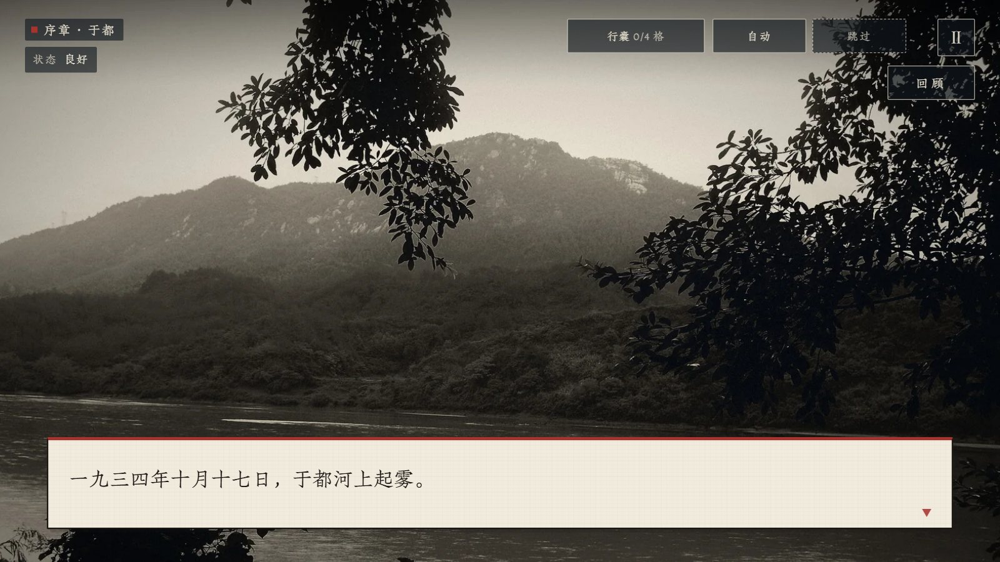
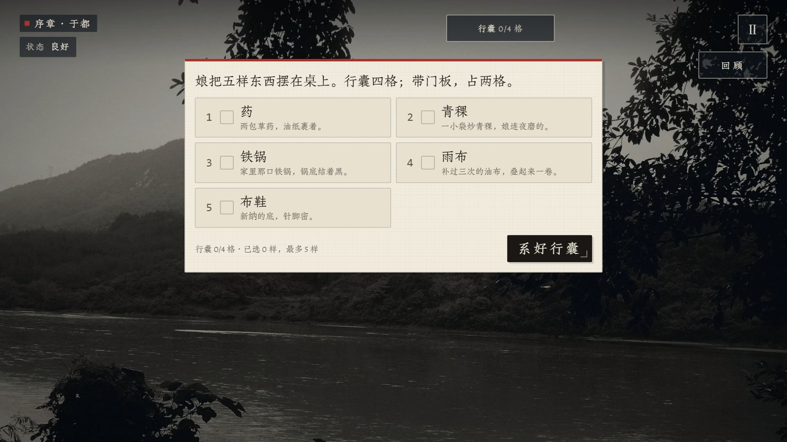
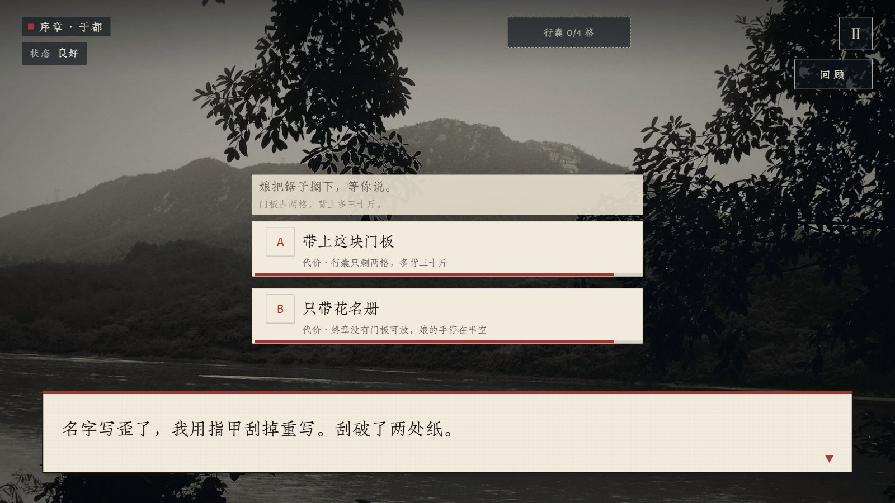
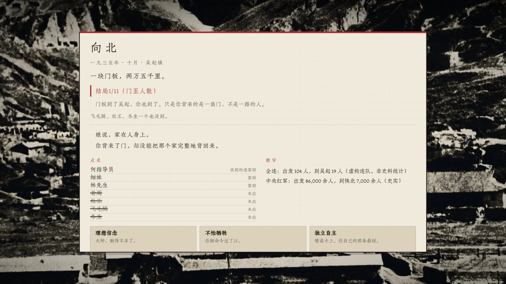
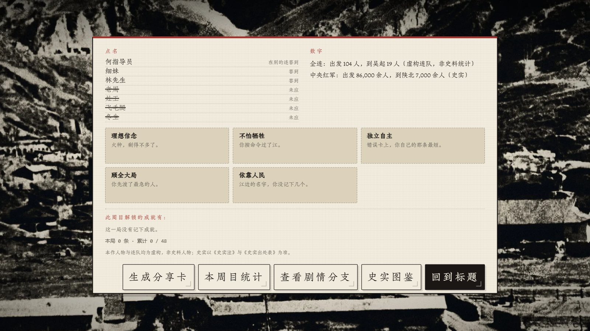

# 向北

> 一块门板，两万五千里。

《向北》是一款原生 HTML5 的网页互动叙事游戏。你扮演长征途中红一方面军某连的 16 岁文书，从于都出发，背着一块从自家门上锯下的木板，走到吴起。

七段路，四段核心选择，三次救人危机，十一条人物结局。历史终点不变；你能改变的是带什么、救谁、记住谁，以及最后是谁走到吴起。

`v1.9.2-dev` · 原生 HTML / CSS / JavaScript · 运行时无框架 · 无构建链 · 无后端 · 可离线


## 在线游玩

| 站点 | 地址 | 说明 |
|---|---|---|
| 主站（Netlify） | **[xiangbei.netlify.app](https://xiangbei.netlify.app/)** | 通常最快 |
| 备用（Cloudflare Pages） | [xiangbei-vn.pages.dev](https://xiangbei-vn.pages.dev/) | 暂为 v1.9.1-dev，待凭据补部署 |
| 备用（GitHub Pages） | [nanxiangzizui.github.io/xiangbei](https://nanxiangzizui.github.io/xiangbei/) | 仓库 `main` 分支自动发布 |

- 建议使用桌面浏览器；手机请横屏，竖屏会提示转屏。
- 声音在第一次点击后才会启用。
- 进度只存在当前浏览器的 `localStorage`，不上传服务器。
- 标题页第一项「开始 / 继续」打开存档面板；第一次玩选「开启新档」。

## 故事

一九三四年十月十七日，于都河上起雾。

娘把家里的门板锯下来，给你背上。门板可以铺桥、可以写字、可以当床板；它占掉行囊的一半，也压着后面的每一段路。

湘江、遵义、金沙江、泸定、草地、吴起。历史的大事件不会因为你改变：湘江必败，遵义会议必开，泸定桥必夺，队伍必须走到吴起。能改变的是代价——谁被留下，谁被记住，谁最后替你答到。

> 虚构人物，非史料人物。满崽、老周、何指导员、张老幺、飞毛腿、灶王、冬生等均为虚构；真实人物只进「史实图鉴」，不进剧情对白。

## 玩法

| 段落 | 你要做的选择 |
|---|---|
| 序章·于都 | 行囊四格怎么装；门板占两格，带不带 |
| 一·湘江 | 六样东西里弃三样；回头，还是按命令走 |
| 二·遵义 | 三条自我批评，认不认 |
| 三·金沙江 | 先渡主力、伤员还是炊事班；记不记船工的名字 |
| 四·泸定 | 门板铺桥、用药，还是抱板走（12 秒） |
| 五·草地 | 青稞给谁；救不救灶王（16 秒）、冬生（12 秒） |
| 终章·吴起 | 门板留不留；替谁答到 |

- **行囊四格 = 八个半格。** 药、青稞各半格；布鞋一格；铁锅、雨布、门板各两格。带门板，就只剩两格。
- **状态 0–4。** 优秀 / 良好 / 勉强 / 差 / 死。救人、挨饿、受伤都会改变状态；状态不是分数，是后面每段路的底气。
- **门板不是道具。** 它不能在物资栏里「使用」；铺在桥上就留在桥上，背到吴起才能放下。
- **没有 Game Over。** 坏结局是叙事结算，不是重开惩罚；失败只改变代价。
- **没有全活。** 十一条人物结局：带门板五种，无门板五种，坏结局一种。救的人越多，你自己越可能倒在草地。
- **五张精神卡。** 只改亮度与一句文案，不改变历史终点；全灰也合法。

### 五张精神卡落在哪里

| 卡 | 机制 |
|---|---|
| 理想信念 | 于都：你带走的火种与门板 |
| 不怕牺牲 | 湘江：谁留在江东岸；草地尽头：谁把自己留下 |
| 独立自主、实事求是 | 遵义：错误卡上，你认不认自己走错的那一步 |
| 顾全大局、严守纪律 | 金沙江：主力先过江，你排到最后 |
| 依靠人民、艰苦奋斗 | 金沙江：记住船工的名字；草地：分粮、背锅、救人 |

> 不喊口号。精神落在动作和代价上，结尾不总结「长征精神是什么」。

### 结局之后

- **点名与数字。** 七名同伴，有人应到，有人未应，有人替你答到；虚构连队 104 人出发，到吴起 19 人（空页与坏结局 18 人），中央红军 86,000 余人出发、到陕北 7,000 余人（史实）。
- **五张精神卡。** 亮与灰都保留在本周目记录里。
- **剧情分支图。** 19 组决策、22 个结构节点、11 条结局；已抵达的路线标纸白，未抵达的保持灰锁，不提前泄露选项。
- **史实图鉴。** 七张，120–220 字，逐条注明出处；有争议的细节写「有不同说法」。
- **成就。** 48 条选择成就（46 条选择 + 2 条记名），未解锁只显示灰框。
- **回顾与存档。** 右上「回顾」按存档槽记录本周目台词与选择；40 个存档位；只在章末、暂停保存或开新档时落档。
- **一章重走。** 完成任意结局后，可从剧情分支图选择一章「从此开始」，沿用该章之前的路线与状态。
- **分享卡。** 结局页可生成 1080×1440 PNG；「本周目统计」只读列出七段、五名同伴、七条点名与五张精神卡，不做完成度百分比。

## 截图

| 序章·于都 | 行囊四格 |
|---|---|
|  |  |
| **一九三四年十月十七日，于都河上起雾。** | **带什么，丢什么；门板占两格。** |

| 门板 | 结局 |
|---|---|
|  |  |
| **「带上这块门板」还是「只带花名册」。** | **路线、点名、数字；五卡在下方。** |



> 五张精神卡：理想信念、不怕牺牲、独立自主、顾全大局、依靠人民。灰卡不扣分，也不会被系统提示「走错了」。

## 操作

| 动作 | 键鼠 | 触摸 |
|---|---|---|
| 推进对话 | 点击 / 空格 / Enter | 点对话框 |
| 单选 | 1–3 或点击 | 点选项整卡 |
| 多选 | 1–9 切换，Enter 确认 | 点整卡，再点「系好行囊」 |
| 暂停 | `Esc` | 右上角暂停按钮 |
| 回顾 | 右上「回顾」 | 同上 |
| 自动 / 跳过 | 右上工具条；跳过只对已读生效 | 同上 |
| 设置 | 标题右上「设置」/ 暂停 → 设置 | 同上 |
| 关闭弹层 | `Esc` / `X` | 点 `X` |

字号、文字速度、总音量、配乐、环境音、静音、减少动效都在设置里；`prefers-reduced-motion` 会被尊重。

## 技术

- **原生 HTML5 + CSS3 + ES6。** 没有 React/Vue、没有 Vite/Webpack、没有 npm 运行时依赖、没有后端、没有登录。
- **固定 1280×720 舞台**，等比缩放；Canvas 2D 按 `devicePixelRatio` 放大，程序化版画与照片底图叠加。
- **剧情内联在 `story.js`。** 经典 `<script>` + 全局 `window.XB`，不用 `fetch`/XHR/ES module，保证 `file://` 离线 ZIP 可玩。
- **存档在本地。** 键 `xiangbei.saves.v1`，最多 40 档；单档仍为 v2 结构，保留 v1 迁移；读写包 `try/catch`，隐私模式降级提示「本局无法存档」，不白屏。
- **音频在首次手势后启动。** 5 条 CC0 环境循环 + 8 首 CC0/CC-BY 现代配乐 + Web Audio 合成床与五音动机；没有假造的历史录音。
- **字体随包。** 得意黑（标题）与朱雀仿宋（正文）的 OFL 1.1 子集；加载失败回退宋体。
- **只用相对路径**，不依赖 CDN；三站均为纯静态托管。

## 本地运行

```powershell
# 直接打开（file:// 可跑）
Start-Process ".\project\index.html"

# 或本地静态服务（更接近线上）
python -m http.server 8080 --directory project
# 浏览器打开 http://localhost:8080
```

开发期自检：

```powershell
node --check project/engine.js
node --check project/story.js
node project/tools/check-build.js
node project/tools/smoke.js
node project/tools/check-script.js docs/script
```

打包离线版：

```powershell
python project/tools/release.py
```

`dist/` 是本地打包产物，默认不入库；线上三站均由 `dist/site/` 的静态文件部署（GitHub Pages 发布到 `main` 根目录）。

## 目录

```text
project/                游戏运行代码与资源
  index.html            舞台、UI 层、脚本入口
  style.css             版式、配色、纸墨组件
  engine.js             状态机、输入、存档、转场、音频
  story.js              九章剧情、选项、旗标、史实注
  art.js                Canvas 程序化版画与照片层
  assets/               底图、音频、字体与授权文件
  tools/                开发期自检、打包与预览脚本
docs/                   设定、史料、剧本源、结局账本、测试
step/                   分步骤执行卡
向北-项目计划书.md        范围、排期与验收
```

## 文档

| 文档 | 内容 |
|---|---|
| [项目计划书](向北-项目计划书.md) | 范围、七段结构、排期与验收底线 |
| [故事设定](docs/story-bible.md) | 人物、名册、道具、分幕、五卡、决策记录 |
| [史实锚点与出处](docs/sources.md) | A1–A7 锚点、S1–S15 出处、争议与停用项 |
| [史实图鉴](docs/codex.md) | 游戏内七张图鉴定稿 |
| [结局路线](docs/ending-routes.md) | 11 条人物结局、条件与账本 |
| [状态与存档](docs/state-schema.md) | 存档 JSON、旗标、迁移 |
| [成就](docs/achievements.md) | 48 条成就、描述模板与测试 |
| [剧情分支图](docs/branch-map.md) | 19 组决策、22 个结构节点、收纳契约 |
| [测试用例](docs/test-cases.md) | 主流程、危机、移动端、存档与回顾 |
| [发布记录](docs/release-record.md) | 打包、部署、线上冒烟与已知例外 |

## 史实与虚构

- 大事件结局不可改：湘江必败、遵义会议必开、泸定桥必夺、必须走到吴起。
- 不虚构真实领导人的对话；真实人物只进「史实图鉴」，不进剧情。
- 争议细节标注「有不同说法」：X 光机情形、22 勇士牺牲人数、金沙江船数等。
- 严格区分史实 / 回忆录 / 文学；《七根火柴》《金色的鱼钩》等小说不作为史料。
- 每条史实注都注明出处；完整表见 [docs/sources.md](docs/sources.md)。
- 死亡用「名字被划掉」和留白表现，不做血腥特写，不把牺牲做成分数。
- 敌人不脸谱化；不写「打鬼子」关卡。

## 制作与授权

- 制作、程序、剧本、美术、测试、史料核对：**刘子政**。
- 图像：12 张版画化场景底图，改编自 Wikimedia Commons 的 CC BY / CC BY-SA / PD / CC0 素材；标题插画由豆包 Seedream 生成（虚构场景，非史料照片）。
- 音频：5 条 CC0 环境循环、8 首 CC0/CC-BY 现代配乐，另有 Web Audio 合成床与五音动机。
- 字体：Smiley Sans、Zhuque Fangsong 的 OFL 1.1 子集；未打包任何未授权字体。
- 本仓库是课程作业，非商业项目；未附开源许可证，代码与剧作文本版权归作者。第三方素材逐项授权见 [project/CREDITS.txt](project/CREDITS.txt)。

## 版本状态

`v1.9.2-dev` · 2026-11-16

- GitHub Pages 与 Netlify 已上线 v1.9.2-dev；Cloudflare Pages 仍为 v1.9.1-dev，待 Cloudflare 凭据后补部署。
- 最近一次自动检查（2026-11-16）：`check-build` 52/52、`smoke` 47/47、`check-script` 9 个剧本文件 OK、`textpass` 33/33；物资提示专项 http/file/移动各 78/78、草地补给 63/63；打包冒烟 `dist/site` 与解压 ZIP 各 21/21。
- 已测：主流程、三次危机、物资消耗提示、慢网/断图 LQIP 兜底与重试（normal / 8s 延迟 / abort / 恢复 / `file://` / 844×390 / CPU 6× / 标题首屏）、存档迁移、剧情回顾、章节重玩、移动端横屏模拟、`file://` 离线。
- 待复测：真人 20 分钟计时、11 条路线全量回归、Chrome/Safari/真机、隐私模式。
- `main` 是 GitHub Pages 部署分支；开发在 `v1.4-dev`。`?dev=1` 是测试模式，可跳七章或预置 11 条路线，不写存档，不是正式入口。

> 娘说，家在人身上。

**[从于都出发 →](https://xiangbei.netlify.app/)**
